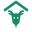
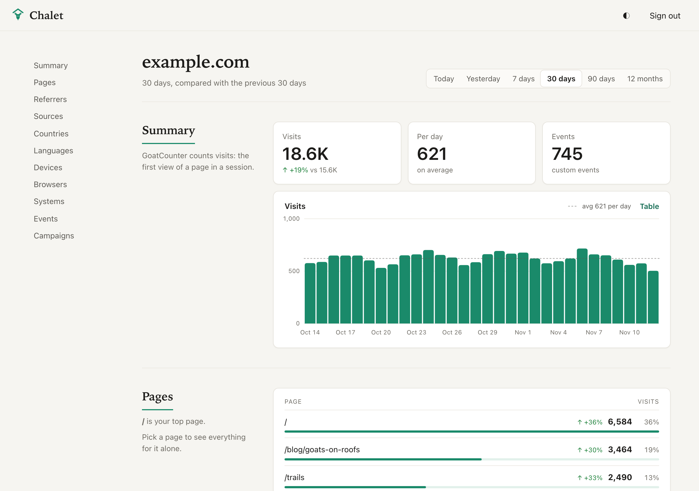
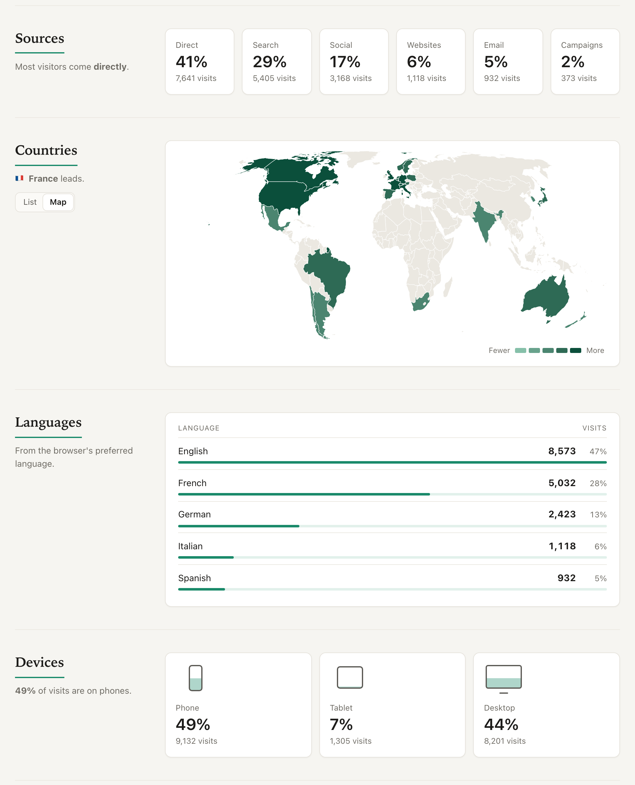

<p align="center">
  
</p>

<h1 align="center">Chalet</h1>

<p align="center">
  A calm, minimal dashboard for <a href="https://www.goatcounter.com">GoatCounter</a>.
  <br>
  <a href="https://flibustier.github.io/chalet/"><strong>Open Chalet</strong></a>
  ·
  <a href="#host-it-yourself">Host it yourself</a>
</p>

<p align="center">
  <picture>
    <source media="(prefers-color-scheme: dark)" srcset="docs/screenshot-dark.png">
    
  </picture>
</p>

Chalet reads your statistics through GoatCounter's API and shows them on one quiet page:
visits over time, pages, referrers, sources, countries, languages, devices, browsers,
systems, events and campaigns, each compared with the previous period.

- **Nothing to install on your server.** Chalet is a static web app. It talks to your
  GoatCounter directly from the browser, so it works with a self-hosted instance as well as
  with goatcounter.com.
- **All your sites in one place.** One API key opens every site of your account.
- **Pick a page** and the whole dashboard narrows to it: where its visitors come from, their
  countries, their devices.
- **Any day, hour by hour**: click a day in the chart, pick one in the calendar, then step
  to the day before or after. The browser's back button returns to where you were.
- **Countries as a list or on a map**, and the visits chart with its average.
- **Light and dark**, following your device or your choice. Works on a phone.

<p align="center">
  <picture>
    <source media="(prefers-color-scheme: dark)" srcset="docs/sections-dark.png">
    
  </picture>
</p>

## Use it

Chalet runs at **https://flibustier.github.io/chalet/**, or on your own host (see below).

1. In GoatCounter, open *Settings → API* and create a key with the **Read statistics**
   permission only.
2. Open Chalet, enter your GoatCounter address (for example `stats.example.com`) and the key.

The key is kept in your browser (local storage) and is only ever sent to your GoatCounter.
Chalet has no server and makes no third-party requests.

The copy at flibustier.github.io/chalet counts its own visits with GoatCounter: the page address and
a fixed title only, never which sites you look at. A copy you build yourself counts nothing
unless you ask it to (see below).

GoatCounter allows 4 API requests per second, and a browser spends two per call (a CORS
preflight, then the request). Chalet spaces its calls and loads the sections in page order,
so a dashboard takes a few seconds to fill in; going back to a period seen in the last
minute is instant.

## Host it yourself

```sh
npm ci
npm run build
```

Serve the `dist/` folder from any static host. It uses relative paths, so a subfolder (a
GitHub Pages project site, for instance) works too.

To count the visits of your copy in your own GoatCounter, build it with its address:
`VITE_GOATCOUNTER=https://stats.example.com npm run build`.

## Develop

```sh
npm ci
npm run dev        # http://localhost:5173
npm run type-check
npx playwright install chromium firefox
npm run test:e2e   # against a fake GoatCounter, no key needed
npm run screenshots # regenerates the pictures above, from made-up data
```

## What GoatCounter does not measure

GoatCounter counts *visits*: the first view of a page in a session. It doesn't record
page views per visit, bounce rate or time on page, so Chalet doesn't show them.

## License

Chalet is free software: you can redistribute it and/or modify it under the terms of the
[GNU Affero General Public License](LICENSE), version 3 or (at your option) any later version.
If you run a modified copy for others to use over a network, you must offer them its source.

Copyright © 2026 the Chalet contributors.

Chalet is an independent project, not affiliated with GoatCounter. The world map uses
[Natural Earth](https://www.naturalearthdata.com) outlines (public domain) via
[world-atlas](https://github.com/topojson/world-atlas).
